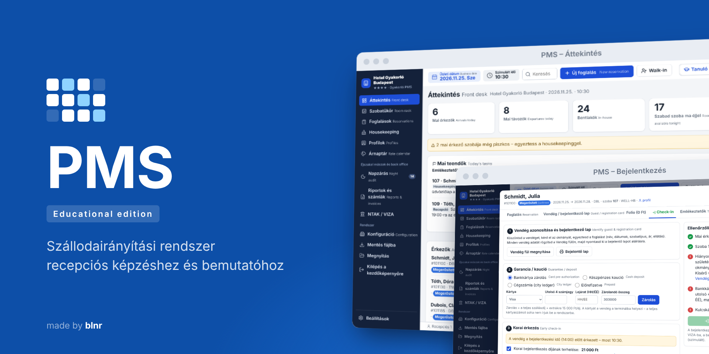
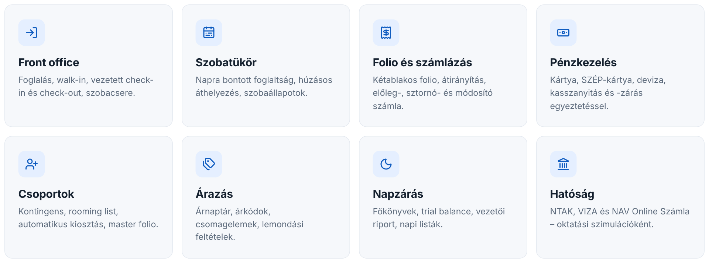
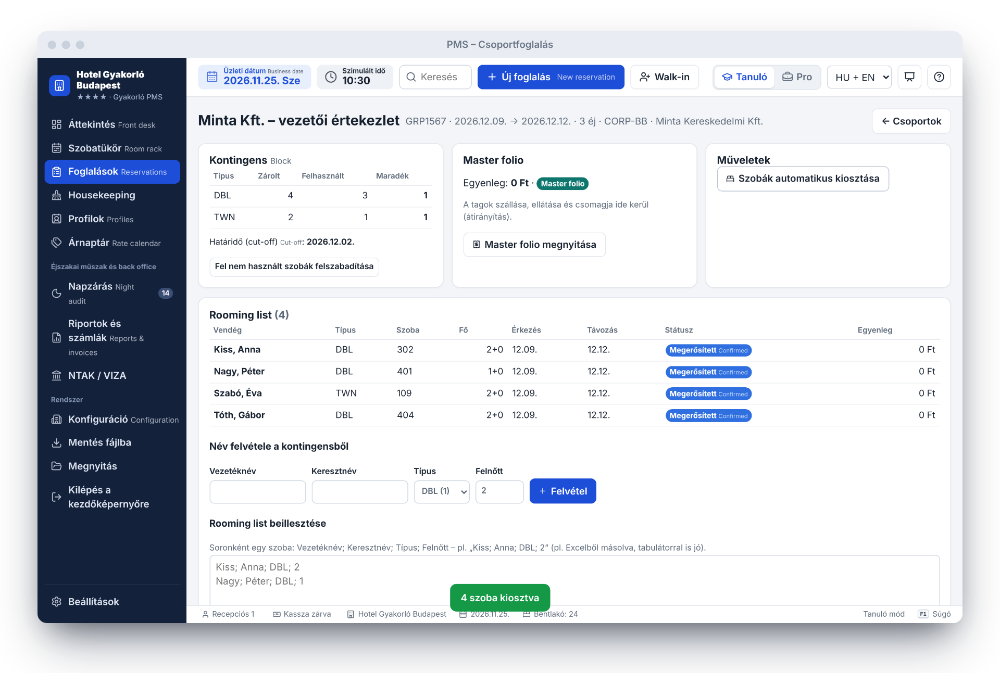
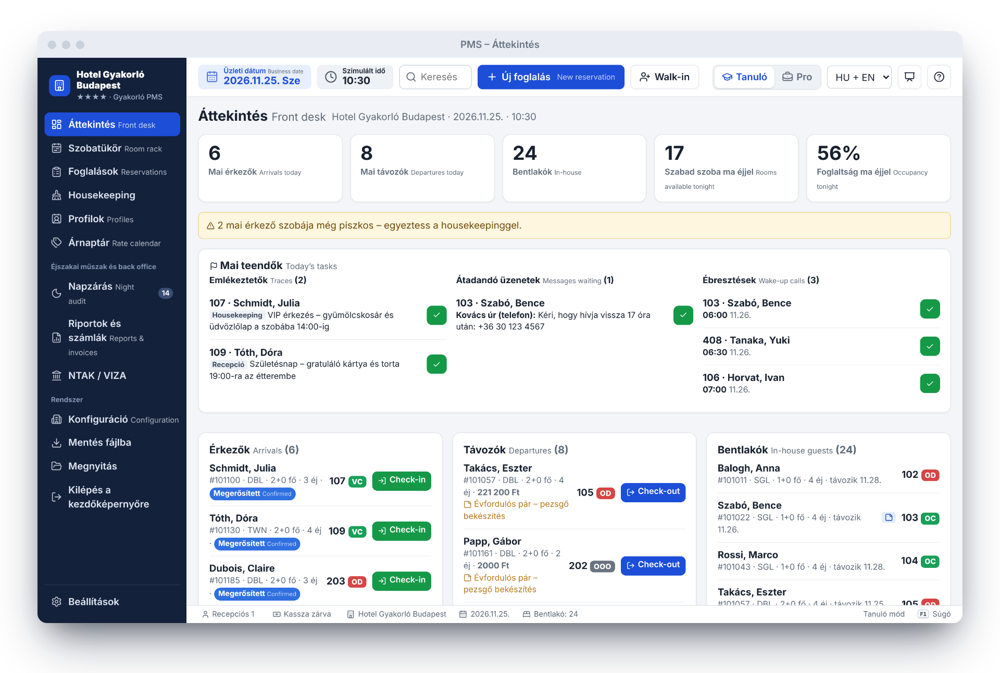

  

  
  
  
  

  A szállodai front office teljes munkafolyamata egyetlen programban – 
  foglalástól a napzárásig, valós szállodai rendszerek mintájára.

  

 

<picture>
  <source media="(prefers-color-scheme: dark)" srcset="docs/features-dark.png">
  
</picture>

  

  

 

<table>
  <tr>
    <td width="50%"></td>
    <td width="50%"></td>
  </tr>
  <tr>
    <td align="center"><b>Szobatükör</b> Foglaltság napra bontva, húzásos áthelyezés</td>
    <td align="center"><b>Folio</b> Terhelések, befizetések, számlázás</td>
  </tr>
  <tr>
    <td></td>
    <td></td>
  </tr>
  <tr>
    <td align="center"><b>Csoportfoglalás</b> Kontingens, rooming list, master folio</td>
    <td align="center"><b>Napzárás</b> Ellenőrzések, főkönyvek, trial balance</td>
  </tr>
  <tr>
    <td></td>
    <td></td>
  </tr>
  <tr>
    <td align="center"><b>Áttekintés</b> Érkezők, távozók, napi teendők</td>
    <td align="center"><b>Sötét téma</b> Állítható megjelenés, betűméret, nyelv</td>
  </tr>
</table>

 

## Indítás

1. Töltse le a legfrissebb verziót a [Releases](https://github.com/blnr999/PMS/releases/latest) oldalról.
2. Indítsa el a letöltött fájlt – telepítés nem szükséges.
3. A kezdőképernyőn az **Azonnali indítás** egy kész mintaszállodát nyit meg gyakorlóadatokkal.

> [!NOTE]
> A program nem rendelkezik digitális aláírással. Ha a Windows SmartScreen figyelmeztet, válassza a **További információ**, majd a **Futtatás mindenképp** lehetőséget.

**Rendszerkövetelmény:** Windows 10 vagy 11 (64 bit) · kb. 400 MB szabad hely · internetkapcsolat nem szükséges

 

## Jogi tudnivalók

A szoftver oktatási és bemutató célra készült. A szereplő vendégek, cégek és adatok kitaláltak; a NAV-, NTAK- és VIZA-adatszolgáltatás, valamint a fizetési és kulcskártya-rendszerek szimulációk. A program nem gyűjt és nem továbbít adatot – minden információ a felhasználó számítógépén marad.

 

<b>English</b>

 

**PMS – Educational edition** is an offline hotel property management system for front office training and demonstrations, modelled on real hotel systems: reservations, room rack, guided check-in and check-out, two-window folios with routing, advance, cancellation and modifying invoices, city ledger, cashier sessions, group blocks with rooming lists, rate calendar with packages and cancellation policies, and a night audit with ledgers, trial balance and management reports.

Download the latest version from [Releases](https://github.com/blnr999/PMS/releases/latest) – no installation or internet connection required. All data is fictional; government and payment interfaces are simulated.

 

© 2026 blnr · Minden jog fenntartva

