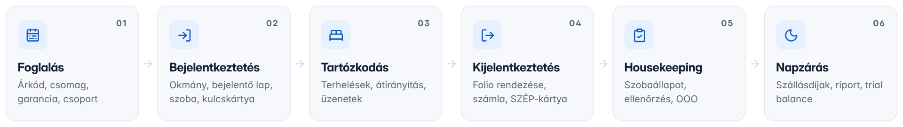
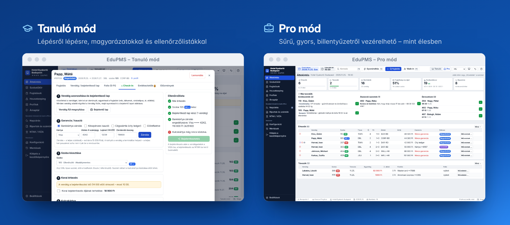
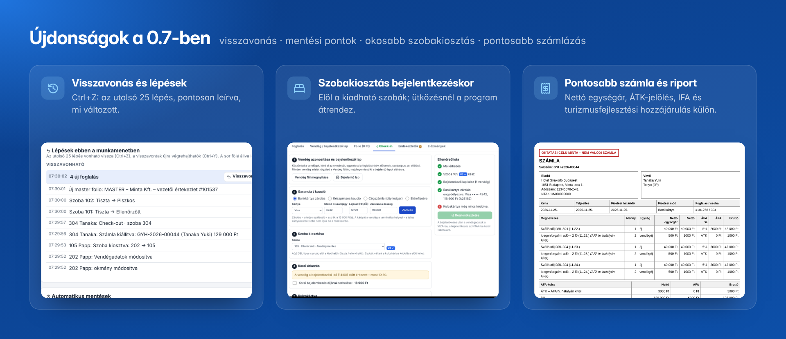
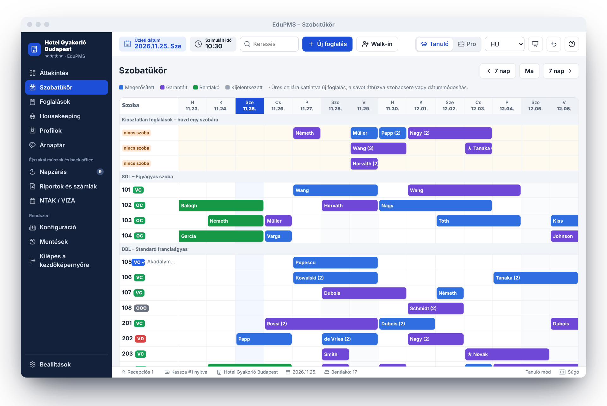
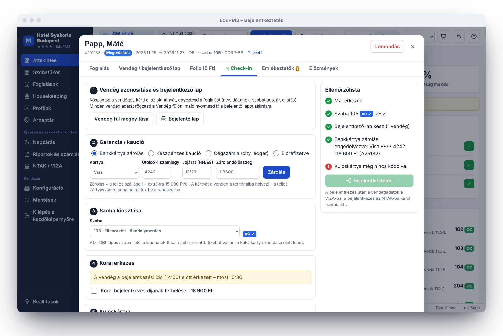
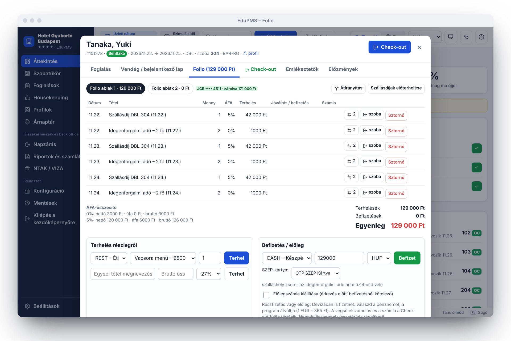
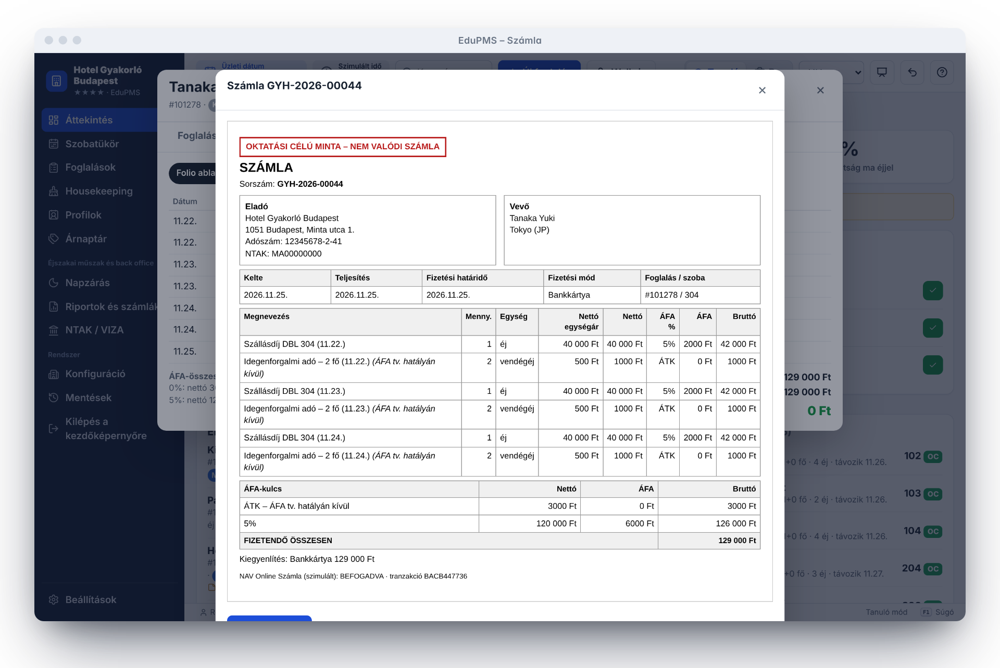
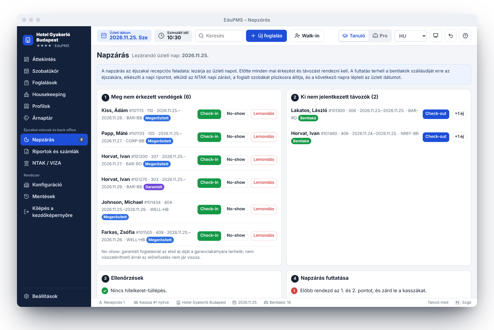
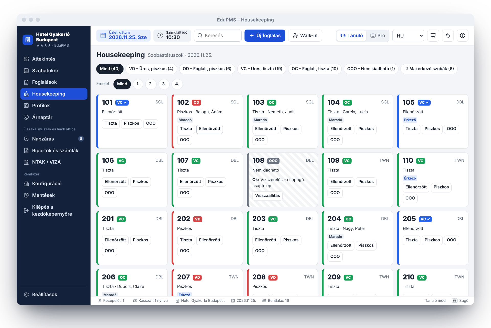
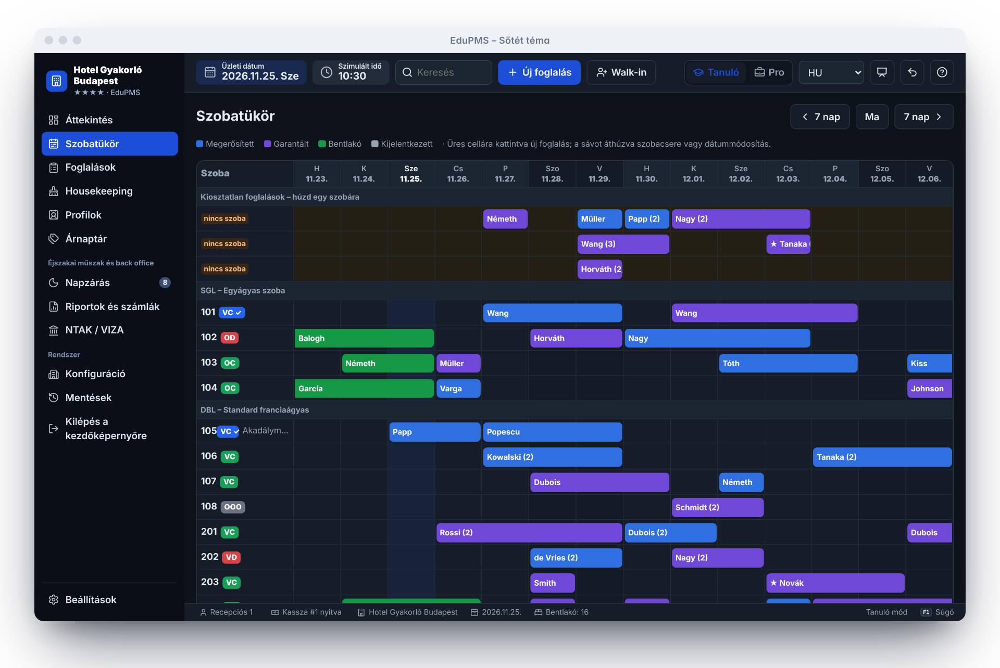

  

  
  
  
  

<h3 align="center">Szállodairányítás a gyakorlatban – telepítés és internet nélkül.</h3>

  Az EduPMS a szállodai recepció és back office teljes munkafolyamatát hozza el egyetlen programban. 
  Valós szállodai rendszerek mintájára készült turisztikai és vendéglátó szakképzéshez, gyakorláshoz és bemutatókhoz.

  

 

## Egy szállodai nap, elejétől a végéig

A program a recepció valós sorrendjét követi: a foglalástól a vendég érkezésén és tartózkodásán át a kijelentkeztetésig, majd az éjszakai napzárásig. Minden lépés ugyanúgy működik, ahogy egy szálloda rendszerében.

<picture>
  <source media="(prefers-color-scheme: dark)" srcset="docs/workflow-dark.png">
  
</picture>

  

## Mit tud?

<picture>
  <source media="(prefers-color-scheme: dark)" srcset="docs/features-dark.png">
  
</picture>

  

## Két mód, egy program

A **Tanuló mód** minden lépésnél elmagyarázza, mi történik és miért, és ellenőrzőlistával vezeti végig a feladatot. A **Pro mód** sűrű, gyors felülete egy élesben használt rendszer ritmusát adja, billentyűparancsokkal. A kettő között egy kattintással lehet váltani, a szálloda adatai közösek.

  

 

  

 

## Képernyőképek

<table>
  <tr>
    <td width="50%"></td>
    <td width="50%"></td>
  </tr>
  <tr>
    <td align="center"><b>Szobatükör</b> Foglaltság napra bontva, húzásos áthelyezés</td>
    <td align="center"><b>Bejelentkeztetés</b> Vezetett lépések, szobakiosztás, ellenőrzőlista</td>
  </tr>
  <tr>
    <td></td>
    <td></td>
  </tr>
  <tr>
    <td align="center"><b>Folio</b> Terhelések, befizetések, átirányítás</td>
    <td align="center"><b>Számla</b> ÁFA-bontás, nettó egységár, NAV-szimuláció</td>
  </tr>
  <tr>
    <td></td>
    <td></td>
  </tr>
  <tr>
    <td align="center"><b>Csoportfoglalás</b> Kontingens, rooming list, master folio</td>
    <td align="center"><b>Napzárás</b> Ellenőrzések, főkönyvek, trial balance</td>
  </tr>
  <tr>
    <td></td>
    <td></td>
  </tr>
  <tr>
    <td align="center"><b>Housekeeping</b> Szobaállapotok, ellenőrzés, nem kiadható szobák</td>
    <td align="center"><b>Sötét téma</b> Állítható megjelenés, betűméret és nyelv</td>
  </tr>
</table>

 

## Indítás

1. Töltse le a legfrissebb verziót a [Releases](https://github.com/blnr999/PMS/releases/latest) oldalról.
2. Indítsa el a letöltött fájlt – telepítés nem szükséges, pendrive-ról is futtatható.
3. A kezdőképernyőn az **Azonnali indítás** egy kész mintaszállodát nyit meg gyakorlóadatokkal. Első indításkor egy rövid bemutató végigvezet a felületen.

> [!NOTE]
> A program nem rendelkezik digitális aláírással. Ha a Windows SmartScreen figyelmeztet, válassza a **További információ**, majd a **Futtatás mindenképp** lehetőséget.

**Rendszerkövetelmény:** Windows 10 vagy 11 (64 bit) · kb. 400 MB szabad hely · internetkapcsolat nem szükséges

 

## Kinek készült?

<table>
  <tr>
    <td width="33%" valign="top"><b>Oktatóknak</b> Saját szálloda beállítása varázslóval, mentési pontok a gyakorlatok kiinduló állapotához, egységesen kiosztható beállítások.</td>
    <td width="33%" valign="top"><b>Diákoknak</b> Biztonságos gyakorlás valós munkafolyamatokon: minden lépés visszavonható, a Súgó és a fogalomtár magyarul és angolul is elérhető.</td>
    <td width="33%" valign="top"><b>Bemutatókhoz</b> Egy kattintással induló mintaszálloda, kivetítő mód és világos, áttekinthető felület.</td>
  </tr>
</table>

 

## Jogi tudnivalók

A szoftver oktatási és bemutató célra készült. A szereplő vendégek, cégek és adatok kitaláltak; a számlák, a NAV-, NTAK- és VIZA-adatszolgáltatás, valamint a fizetési és kulcskártya-rendszerek szimulációk. A program nem gyűjt és nem továbbít adatot – minden információ a felhasználó számítógépén marad.

 

<b>English</b>

 

**EduPMS** is an offline hotel property management system for hospitality training and demonstrations, modelled on real hotel systems. It covers the full front office and back office day: reservations and group blocks, room rack, guided check-in and check-out with room assignment, two-window folios with routing, advance, cancellation and modifying invoices, city ledger, cashier sessions, housekeeping, rate calendar with packages and cancellation policies, and a night audit with ledgers, trial balance and management reports.

A **Study mode** explains every step with checklists; a **Pro mode** offers a dense, keyboard-driven interface. Every change can be undone, the hotel is backed up automatically, and named save points make it easy to return to the starting state of an exercise.

Download the latest version from [Releases](https://github.com/blnr999/PMS/releases/latest) – no installation or internet connection required. The interface is available in Hungarian, English, or Hungarian with English terms. All data is fictional; government and payment interfaces are simulated.

 

© 2026 blnr · Minden jog fenntartva

