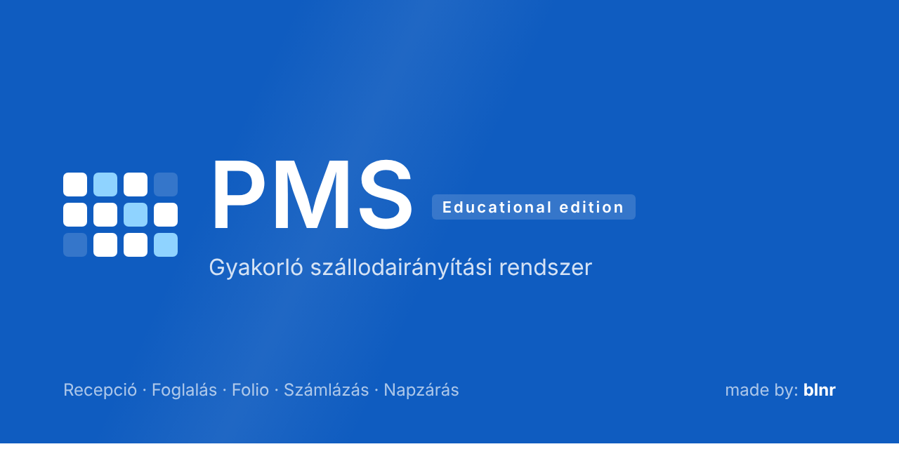
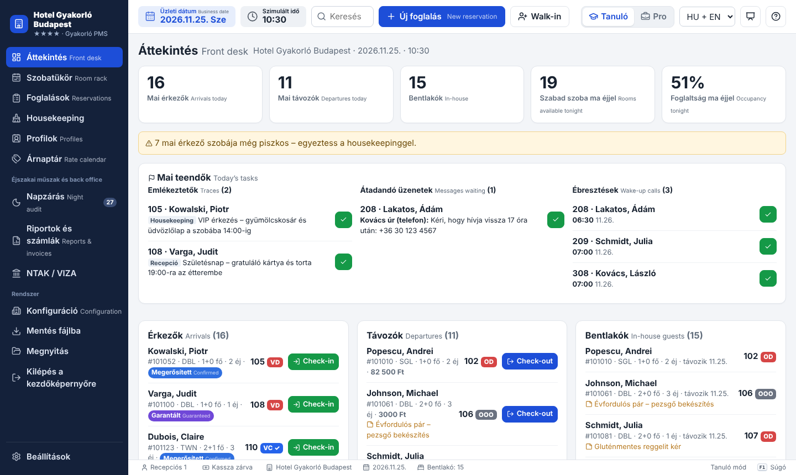
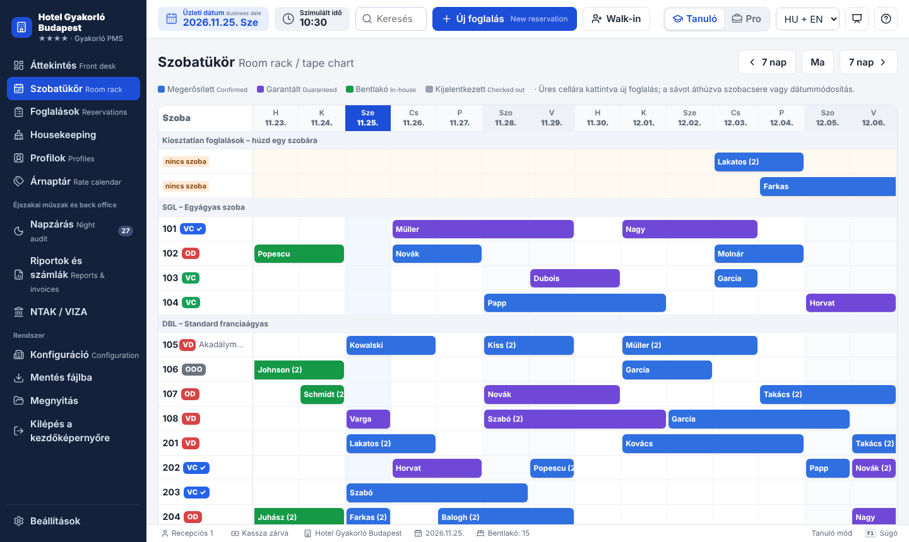
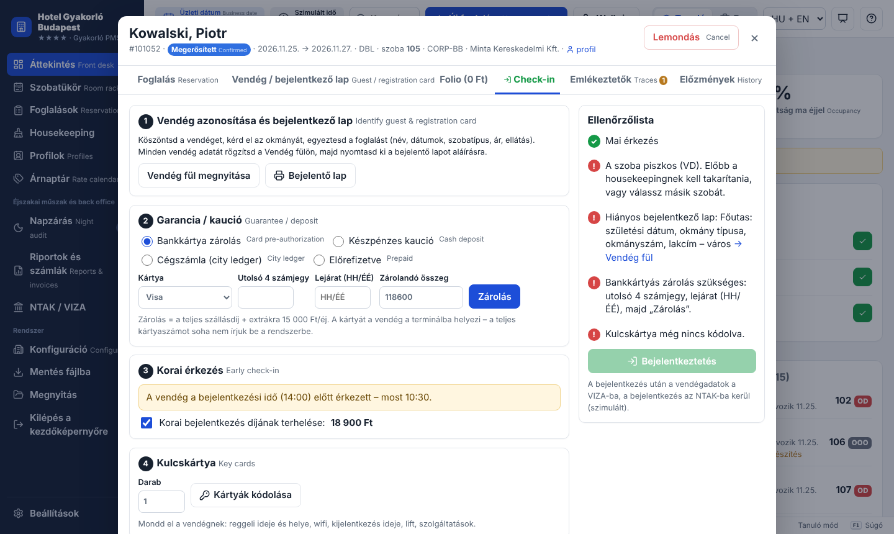
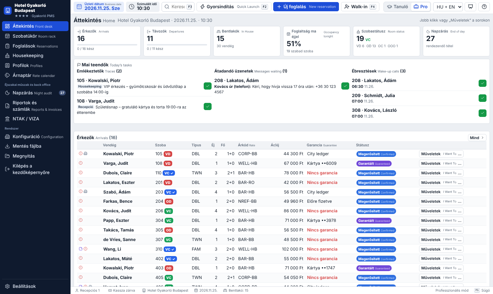
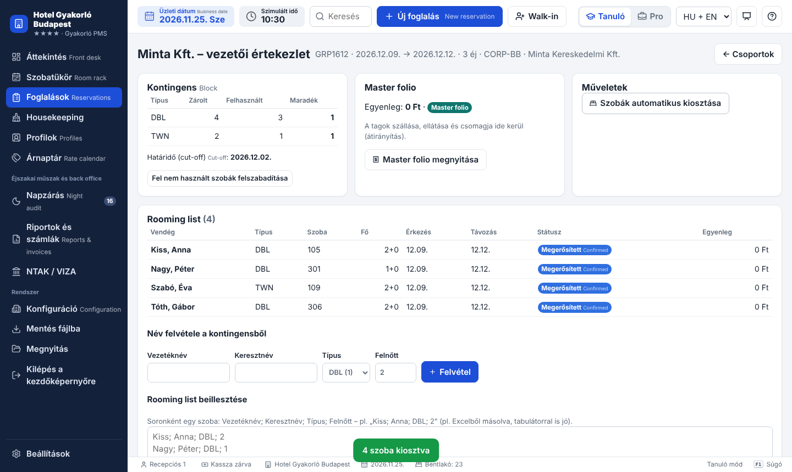
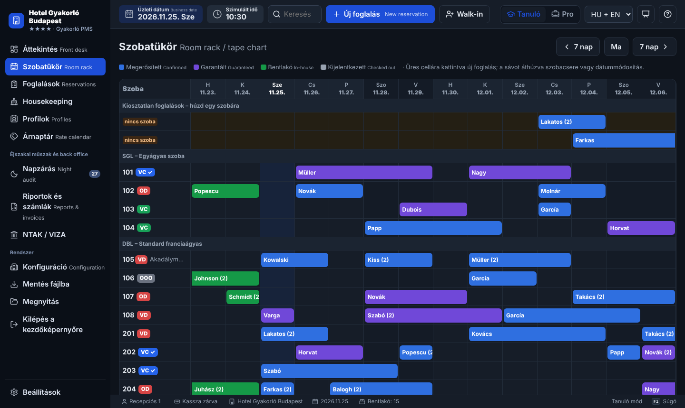

  

  
  
  
  

<h3 align="center">Szállodairányítási rendszer recepciós képzéshez és bemutatóhoz</h3>

  A PMS – Educational edition a szállodai front office teljes munkafolyamatát modellezi: 
  foglalás, bejelentkezés, tartózkodás, elszámolás és napzárás – valós szállodai rendszerek mintájára.

  

 

## Funkciók

<table>
  <tr>
    <td width="50%" valign="top">
      <h4>Front office</h4>
      Foglaláskezelés és walk-in, szobatükör húzásos áthelyezéssel, bejelentkezés ellenőrzőlistával
      (bejelentő lap, fizetési garancia, kulcskártya), szobacsere, kijelentkezés.
    </td>
    <td width="50%" valign="top">
      <h4>Folio és számlázás</h4>
      Kétablakos folio, terhelés-átirányítás, előlegszámla, sztornó és módosító számla,
      cégszámla és kintlévőség-kezelés.
    </td>
  </tr>
  <tr>
    <td valign="top">
      <h4>Pénzkezelés</h4>
      Készpénz, bankkártya, átutalás, SZÉP-kártya és devizás fizetés (HUF / EUR),
      felhasználónkénti kasszanyitás és -zárás egyeztetéssel.
    </td>
    <td valign="top">
      <h4>Csoportfoglalás</h4>
      Kontingens szobatípusonként, rooming list importálása, automatikus szobakiosztás,
      master folio és határidő (cut-off) kezelése.
    </td>
  </tr>
  <tr>
    <td valign="top">
      <h4>Árazás és értékesítés</h4>
      Árnaptár, árkódok, csomagelemek, lemondási feltételek, értékesítési korlátozások
      és piaci szegmensek.
    </td>
    <td valign="top">
      <h4>Napzárás és riportok</h4>
      Éjszakai terhelések, főkönyvek és trial balance, napi vezetői riport (foglaltság, ADR, RevPAR),
      nyomtatható napi listák.
    </td>
  </tr>
  <tr>
    <td valign="top">
      <h4>Napi működés</h4>
      Emlékeztetők részlegenként, vendégüzenetek, ébresztés, housekeeping-állapotok
      és szobalista.
    </td>
    <td valign="top">
      <h4>Hatósági adatszolgáltatás</h4>
      NTAK- és VIZA-adatküldés, valamint NAV Online Számla – oktatási célú szimulációként.
    </td>
  </tr>
</table>

**Két munkamód.** A *Tanuló mód* minden lépést magyaráz és ellenőrzőlistával vezet; a *Pro mód* sűrű, billentyűzetről vezérelhető felülete éles rendszerek kezelését idézi. A felület magyar, angol szakkifejezésekkel kiegészítve, vagy teljesen angol.

 

## Képernyőképek

<table>
  <tr>
    <td width="50%"></td>
    <td width="50%"></td>
  </tr>
  <tr>
    <td align="center">Áttekintés – érkezők, távozók, napi teendők</td>
    <td align="center">Szobatükör</td>
  </tr>
  <tr>
    <td></td>
    <td></td>
  </tr>
  <tr>
    <td align="center">Bejelentkezés ellenőrzőlistával</td>
    <td align="center">Folio – terhelések, befizetések, számla</td>
  </tr>
  <tr>
    <td></td>
    <td></td>
  </tr>
  <tr>
    <td align="center">Pro mód</td>
    <td align="center">Csoportfoglalás és rooming list</td>
  </tr>
  <tr>
    <td></td>
    <td></td>
  </tr>
  <tr>
    <td align="center">Napzárás</td>
    <td align="center">Sötét téma</td>
  </tr>
</table>

 

## Telepítés

1. Töltse le a legfrissebb `GyakorloPMS-<verzió>-portable.exe` fájlt a [Releases](https://github.com/blnr999/PMS/releases/latest) oldalról.
2. Indítsa el a fájlt. Telepítés nem szükséges; a program hordozható adathordozóról is futtatható.
3. A kezdőképernyőn az **Azonnali indítás** gombbal egy mintaszálloda nyílik meg gyakorlóadatokkal, vagy a beállítóvarázslóval saját szálloda hozható létre.

> [!NOTE]
> A program nem rendelkezik digitális aláírással, ezért első indításkor a Windows SmartScreen figyelmeztetést jeleníthet meg.
> Az indításhoz válassza a **További információ**, majd a **Futtatás mindenképp** lehetőséget.

### Rendszerkövetelmények

| | |
|---|---|
| Operációs rendszer | Windows 10 vagy 11, 64 bites |
| Szabad tárhely | kb. 400 MB |
| Internetkapcsolat | nem szükséges |

 

## Kezelés

| Billentyű | Funkció |
|---|---|
| `F1` | Súgó, magyar–angol fogalomtár, bemutató |
| `F2` | Új foglalás |
| `F3` | Keresés |
| `F4` | Walk-in |
| `Alt` + `1…9` | Menüpontok |

A szálloda állapota bármikor fájlba menthető és visszatölthető, így egy kiinduló helyzet tetszőleges alkalommal újra felhasználható.

 

## Jogi tudnivalók

A szoftver kizárólag **oktatási és bemutató célra** készült. A programban szereplő vendégek, cégek és adatok kitaláltak. A számlák, a NAV-, NTAK- és VIZA-adatszolgáltatás, valamint a fizetési és kulcskártya-rendszerek szimulációk; a program valós szállodai üzemeltetésre nem alkalmas.

A program nem gyűjt és nem továbbít adatot – minden információ kizárólag a felhasználó számítógépén tárolódik.

 

<b>English</b>

 

**PMS – Educational edition** is an offline hotel property management system for front office training and demonstrations, modelled on real hotel systems.

It covers reservations and walk-ins, a drag-and-drop room rack, guided check-in and check-out, two-window folios with routing, advance, cancellation and modifying invoices, city ledger, per-user cashier sessions, group blocks with rooming lists and master folios, a rate calendar with packages and cancellation policies, and a night audit with ledgers, trial balance and management reports.

Download the portable executable from [Releases](https://github.com/blnr999/PMS/releases/latest) – no installation or internet connection required. All data is fictional; government and payment interfaces are simulated.

 

© 2026 blnr · Minden jog fenntartva

