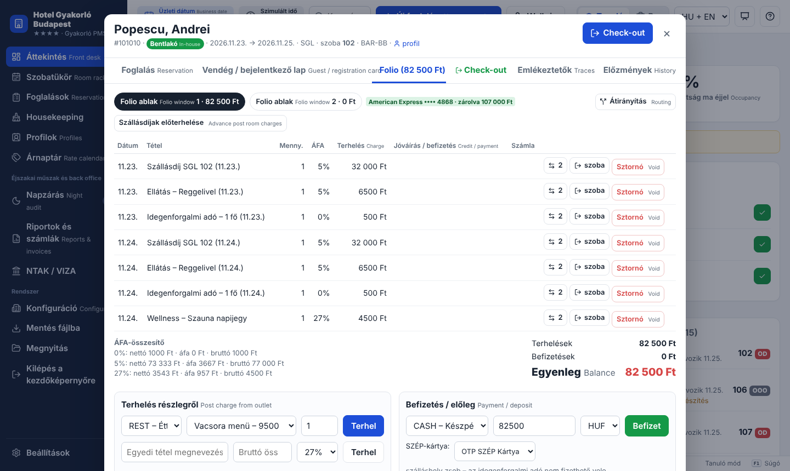
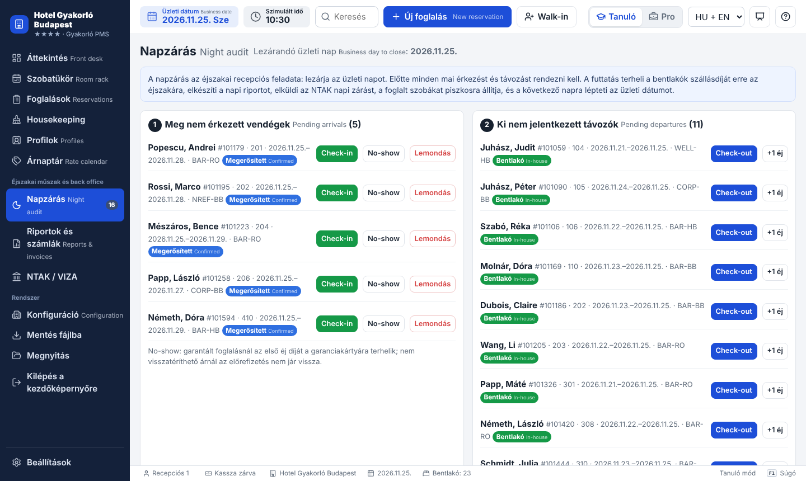

  

  
  
  
  
  

  <b>Ingyenes, offline szállodairányítási rendszer (PMS) recepciós gyakorláshoz és bemutatóhoz.</b> 
  Valódi szállodai rendszerek mintájára – foglalástól a napzárásig.

  

---

## ✨ Mit tud?

| | |
|---|---|
| 🛎️ **Recepció** | Foglalás, walk-in, check-in (bejelentkező lap, garancia, kulcskártya), szobacsere, check-out |
| 🗓️ **Szobatükör** | Napra bontott foglaltság, húzással áthelyezés, szobaállapotok (VC / VD / OC / OD / OOO) |
| 💳 **Folio és számlázás** | Két ablakos folio, átirányítás, előlegszámla, sztornó és módosító számla, cégszámla (city ledger) |
| 💶 **Fizetés** | Készpénz, kártya, átutalás, SZÉP-kártya, devizás fizetés (HUF / EUR), kasszanyitás és -zárás |
| 👥 **Csoportok** | Kontingens, rooming list beillesztése, master folio, határidő (cut-off) |
| 🏷️ **Árazás** | Árnaptár, árkódok, csomagelemek, lemondási feltételek, korlátozások |
| 🌙 **Napzárás** | Éjszakai terhelések, főkönyvek és egyeztetés (trial balance), napi vezetői riport |
| 📋 **Napi munka** | Emlékeztetők, vendégüzenetek, ébresztés, nyomtatható napi listák, housekeeping |
| 🏛️ **Hatóság (szimulált)** | NTAK- és VIZA-adatküldés, NAV Online Számla minta |
| 🎓 **Két mód** | *Tanuló mód* magyarázatokkal és ellenőrzőlistákkal · *Pro mód* sűrű, éles rendszerhez hasonló felülettel |

## 🖼️ Képernyőképek

<table>
  <tr>
    <td>
Áttekintés – mai érkezők, távozók, teendők
</td>
    <td>
Szobatükör
</td>
  </tr>
  <tr>
    <td>
Check-in ellenőrzőlistával
</td>
    <td>
Folio – terhelések, befizetések, számla
</td>
  </tr>
  <tr>
    <td>
Pro mód
</td>
    <td>
Csoportfoglalás és rooming list
</td>
  </tr>
  <tr>
    <td>
Napzárás
</td>
    <td>
Sötét mód
</td>
  </tr>
</table>

## 🚀 Indítás

1. Töltsd le a legfrissebb fájlt a [Releases](https://github.com/blnr999/PMS/releases/latest) oldalról.
2. Indítsd el dupla kattintással – telepítés nem kell, bárhonnan futtatható (pl. pendrive-ról is).
3. A kezdőképernyőn válaszd az **„Azonnali indítás”** gombot: kész mintaszálloda nyílik, gyakorlóvendégekkel.

> [!NOTE]
> **Windows SmartScreen:** a program nincs digitálisan aláírva, ezért az első indításkor a Windows figyelmeztethet.
> Kattints a **„További információ”**, majd a **„Futtatás mindenképp”** gombra.

**Rendszerkövetelmény:** Windows 10 vagy 11 (64 bites), kb. 400 MB szabad hely. Internetkapcsolat nem kell.

## ⌨️ Hasznos tudnivalók

- **F1** – súgó, magyar–angol fogalomtár, gyorsbillentyűk; első indításkor rövid bemutató is indul
- **F2** új foglalás · **F3** keresés · **F4** walk-in · **Alt+1…9** menüpontok
- A szálloda bármikor **fájlba menthető** és visszatölthető – így egy kiinduló állapot többször is gyakorolható
- A **Beállításokban** állítható a téma (sötét mód is), a betűméret, a nyelv, a dátum- és pénzformátum

## ⚠️ Fontos

Ez **oktatási és bemutató célú** szoftver.
Minden vendég, cég és adat **kitalált**; a számlák, a NAV-, NTAK- és VIZA-adatküldések, a kártyaterminál és a kulcskártya csak **szimulációk** – valódi szállodai működésre nem használható.
A program nem gyűjt és nem küld adatot: minden a saját gépeden marad.

---

<b>🇬🇧 English</b>

**PMS – Educational edition** is a free, offline hotel property management system for front desk training and demos, modelled on real hotel systems: reservations, room rack, check-in/out, two-window folios, invoicing (advance, cancellation and modifying invoices), city ledger, cashier sessions, groups with rooming lists and master folios, rate calendar with packages and cancellation policies, night audit with ledgers and trial balance, daily reports and printable lists. Study mode explains every step; Pro mode looks like a live system. The UI is Hungarian with optional English terms, or fully English.

Download the portable `.exe` from [Releases](https://github.com/blnr999/PMS/releases/latest) – no installation or internet needed. All data is fictional; government and payment interfaces are simulated.

made by <b>blnr</b> · © 2026 · Minden jog fenntartva

